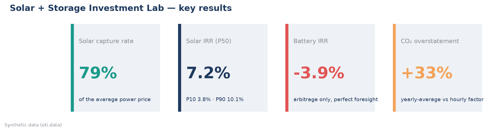
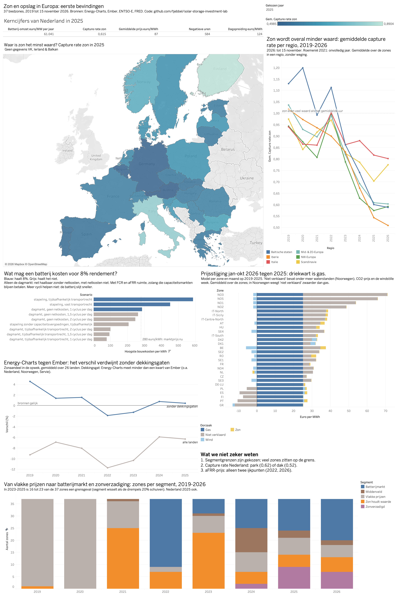
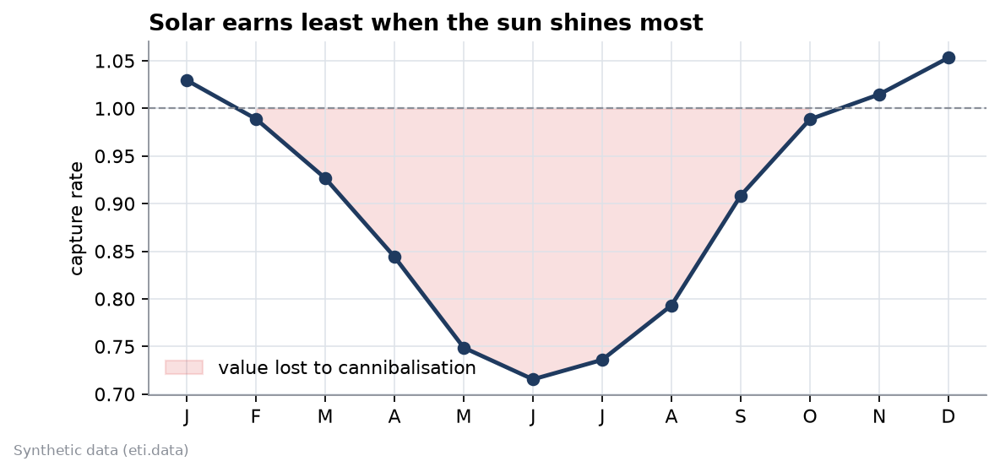
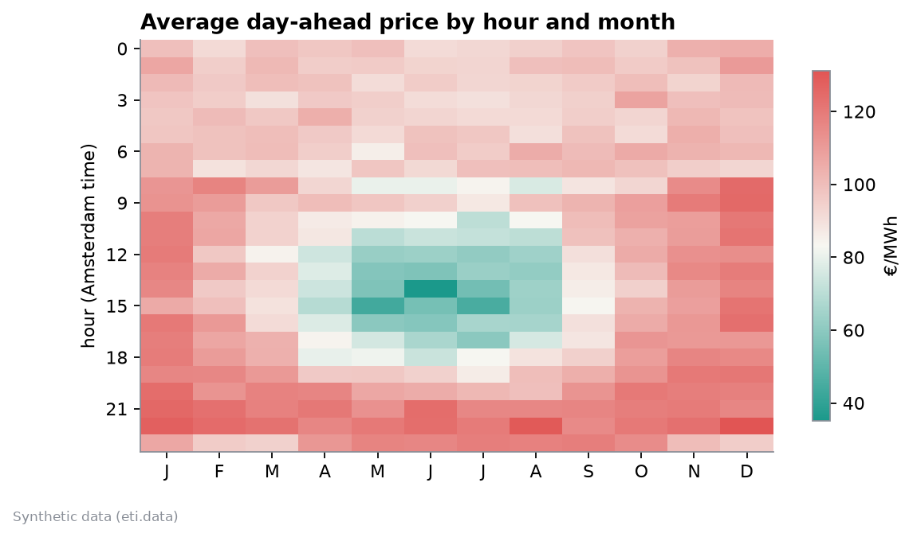
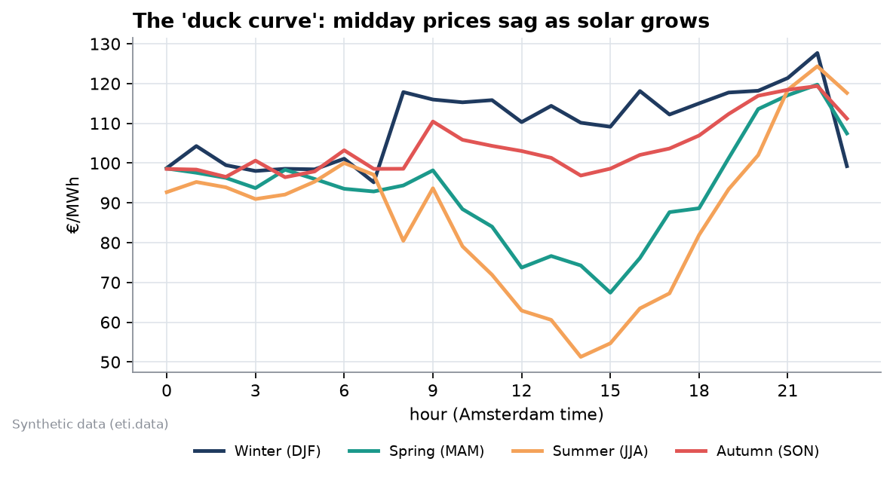
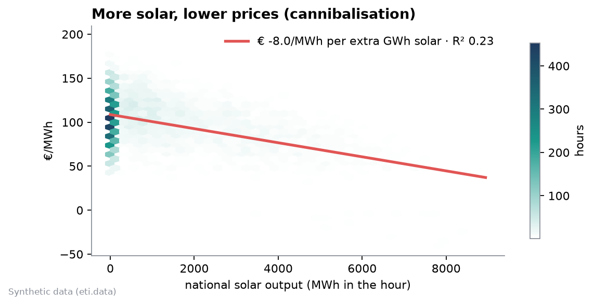
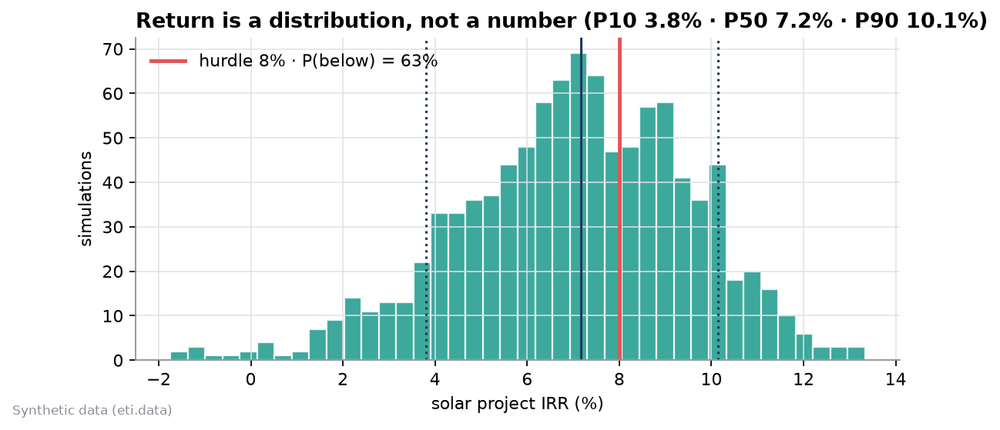
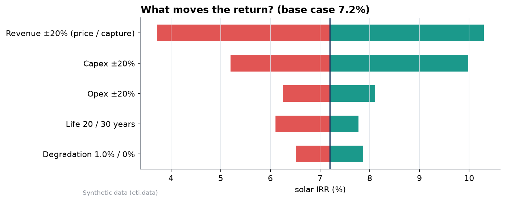
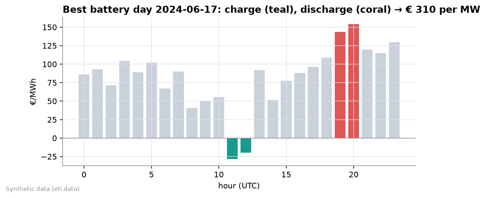
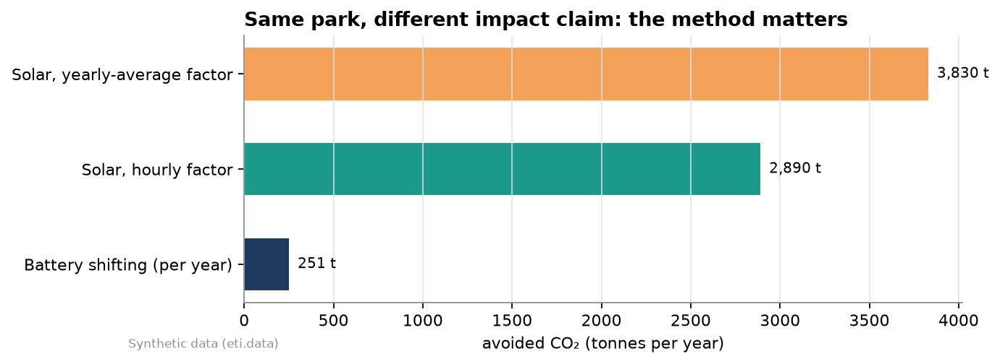

# Solar + Storage Investment Lab

**Should an investor add a battery to a Dutch solar park?** An open, tested analytics pipeline that links
real electricity-market data to investment return, risk and avoided emissions: the questions energy-transition
investors, banks and climate funds ask every day.




## Findings from real market data (2019 to 15 November 2026)

*37 European bidding zones (Energy-Charts, Ember, ENTSO-E), CBS, EIA-860M and the Dutch grid capacity map. Every number
is reproduced by `bash run_analyse.sh` and checked in the control matrix (`tableau/data/t15_controles.csv`, 18 controls).*

* **Dutch solar is worth 38% less than the average hour.** Capture rate 0.62 in 2025 (rank 19 of 37 zones; EU median 0.62),
  down from 0.94 in 2019. Across Europe the capture rate falls about 1.1 points per percentage point of solar share.
* **That is good news for batteries.** 584 negative-price hours in the Netherlands in 2025 (EU median 265), battery revenue
  EUR 61k/MW (EU median EUR 53k). A battery that stacks day-ahead and reserve markets clears 8% up to EUR 586/kWh capex;
  day-ahead alone with grid charges only up to about EUR 100/kWh (market price EUR 280/kWh).
* **2026 price rise: three quarters is gas.** Decomposition per zone and month, 2019-2025 model.
* **Panels get 35% cheaper per doubling of world capacity** (95%: 21-46%). The rate holds without the crisis years and
  without the 2023-24 overcapacity.
* **The grid is the bottleneck.** 56% of Dutch postcodes have a shortage of offtake capacity; Dutch solar capacity grew
  only 4.8% in 2025 (CBS). In the US, utility-scale batteries reached 56 GW / 154 GWh (EIA-860M, September 2026).
* **Nuclear and solar each produced about 2,800 TWh worldwide in 2025.** Matching US nuclear output would take about
  427 GW of solar: one GW of nuclear is not one GW of solar.

## Dashboard series

| # | Dashboard | Lens | Status |
|---|---|---|---|
| 1 | [First findings](https://public.tableau.com/app/profile/tjebbe.lodeizen/viz/NL_solar/Eerstebevindingen) | investor | published; redesign 19 Nov |
| 2 | Signals Netherlands: does solar cover its cost? | analyst | data ready |
| 3 | Nuclear, solar and wind: Europe and the world | policy, investor | data ready |
| 4 | Experience curve and portfolio | BCG | data ready |
| 5 | CO2 abatement cost curve | McKinsey | data ready |
| 6 | Profit pool along the value chain | Bain | planned |
| 7 | Control matrix and risk map | Big Four | data ready |
| 8 | Netherlands: end of net metering, grid congestion | government | data ready |
| 9 | European Union: price convergence | EU | data ready |
| 10 | United States: tax credits and the build-out | US | data ready |
| 11 | China: market prices and the build wave | China | data ready |
| 12 | Stranded assets per climate scenario | central banks | waiting for NGFS data |
| 13 | Grid operator: flexibility and EVs | TSO/DSO | data ready |
| 14 | Impact investor: return against avoided CO2 | climate fund | data ready |
| 15 | Global South: why the cost of capital matters | development | data ready |
| 16-24 | Duck-curve atlas, PPA or merchant, storage saturation, Hirth replication, hourly carbon-free, commodities, workforce, who benefits, hydrogen | follow-up | planned |

The research agenda behind the series is in the reference book (`reports/Naslagwerk_Zon_Opslag_Duurzame_Financiering.pdf`).

## Key findings from the investment model

*Synthetic price year (runs offline); project assumptions from the Dutch PBL SCE 2025 advice for ground-mounted PV
(740 full-load hours, EUR 449/kWp). Rerun with live Dutch data via `make run-live YEAR=2025`. Every figure is in
`reports/numbers.json` (`python -m eti.numbers`).*

* **Cannibalisation is real.** Solar earns 79% of the average power price; every extra GWh of
  national solar lowers the price by about EUR 8/MWh.
* **Dutch merchant solar no longer clears 8%.** IRR 7.2% before and 5.5% after tax; LCOE EUR 76/MWh
  equals the capture price (EUR 77/MWh). Break-even capture rate for 8%: 0.83 (now 0.79).
  At 950 full-load hours: 11.5% / 8.9% after tax.
* **Arbitrage alone does not pay for a battery.** Perfect foresight earns EUR 473k a year; planning on
  yesterday's prices EUR 150k. Grid tariffs of EUR 10/MWh remove 31% of the margin.
* **Impact claims depend on method and place.** An hourly emission factor gives 25% less avoided CO2 than a
  yearly average; a euro in Indian solar avoids about 6x more CO2 than in the Netherlands (2030).

## Tableau dashboard: first findings

[](https://public.tableau.com/app/profile/tjebbe.lodeizen/viz/NL_solar/Eerstebevindingen)

**[Open the interactive dashboard on Tableau Public](https://public.tableau.com/app/profile/tjebbe.lodeizen/viz/NL_solar/Eerstebevindingen)** (Dutch labels).
It shows the solar capture rate across 37 European bidding zones (2019-2026), how zones shift from
flat prices towards battery markets and solar saturation, the 2026 price shock split into gas, wind,
solar and unexplained, and the highest battery capex that still reaches an 8% return.
Workbook: `tableau/NL_solar.twbx`. Data: `tableau/data/` (built with `python -m eti.tableau_export`).
Build guide: `tableau/BOUWGIDS_TABLEAU.md`.

## Power BI

`python -m eti.powerbi` exports a star schema to `powerbi/data/`; `powerbi/measures.dax` holds the DAX measures and
`powerbi/BOUWGIDS.md` the step-by-step build in Microsoft Fabric (works on macOS in the browser).

## Gallery

| | |
|---|---|
|  |  |
|  |  |
|  |  |
|  |  |

## Run it

```bash
git clone https://github.com/tjebbel/solar-storage-investment-lab.git
cd solar-storage-investment-lab
python3 -m venv .venv && source .venv/bin/activate
make setup             # matplotlib, pandas, numpy
make test              # 225+ tests: unit, live-connector fixtures, exercises, end-to-end, analysis packs
make run               # synthetic year, offline → reports/ and reports/figures/
make run-live YEAR=2025   # real Dutch prices and generation from the Energy-Charts API
```

## Analysis packs

Six packs run on the tables in `powerbi/data` and write their own tables, charts and reports (reports are in Dutch):

```bash
pip install -r requirements-analyse.txt
bash run_analyse.sh                     # everything in order, about three minutes
```

| Pack | Code | Output |
|---|---|---|
| Data analysis | `eti.da` | `powerbi/data/*_DA.csv`, `reports/analyse/01_data_analyse_DA.md` |
| Statistics and forecast | `eti.sa`, `eti.prognose` | `powerbi/data/*_SA.csv`, `reports/analyse/02_statistische_analyse_SA.md` |
| Visualisation | `eti.vis`, `eti.rapport_grafieken`, `eti.verken_app` | `reports/analyse/fig/`, `reports/analyse/periodiek/`, `reports/analyse/03_visualisatie.md` |
| Reporting | `eti.woordenboek`, `eti.rapport_auto` | `reports/analyse/04_rapportage.md`, data dictionary and JSON schema |
| SQL | `sql/*.sql`, `eti.sql_run` | `reports/analyse/05_sql.md` |
| Python | `eti.analyse_script`, `eti.ml_pijplijn`, `eti.kwaliteit`, `notebooks/` | `reports/analyse/06_python.md`, `resultaten/` |
| Follow-up: data repairs, battery saturation per GW, gas price, stacking, Power BI test files | `eti.zonprofiel`, `eti.vs_dag`, `eti.verzadiging_gw`, `eti.gas`, `eti.stapel`, `eti.powerbi_toets` | `powerbi/data/*_VZ.csv`, `*_GAS.csv`, `*_ST.csv`, `reports/analyse/07_vervolg.md` |

Tests for these packs skip automatically when scipy, scikit-learn or seaborn is not installed.

## Live data

`eti/live.py` downloads day-ahead prices for the Dutch bidding zone and public net generation per technology
from the [Energy-Charts API](https://api.energy-charts.info/) (Fraunhofer ISE, no key needed), month by month,
caches the raw JSON in `data/raw/` (git-ignored), averages 15-minute values to hours, and maps production types
to technologies. Raw market data is not redistributed; only aggregates and charts are published, with attribution:
*Data: Energy-Charts.info (Fraunhofer ISE); prices from the day-ahead market (EPEX SPOT).* The ENTSO-E parser
(`eti.data.parse_entsoe_xml`) is included for users with an ENTSO-E token.

## How it works

```
Energy-Charts API / ENTSO-E XML / synthetic → SQLite star schema → market analytics → investment model → impact → reports + figures
```

| Module | What it does |
|---|---|
| `eti/live.py` | Live connectors, hourly aggregation, technology mapping |
| `eti/data.py` | Synthetic year; ENTSO-E XML parser; emission factors |
| `eti/warehouse.py` | Star schema, idempotent upserts, analysis view |
| `eti/market.py` | Capture rate, negative hours, cannibalisation regression |
| `eti/battery.py` | Daily arbitrage upper bound in O(n) |
| `eti/finance.py` | NPV, IRR, LCOE, sculpted debt, Monte Carlo, required revenue uplift |
| `eti/esg.py` | Avoided emissions (hourly vs average), battery shifting |
| `eti/figures.py` | Nine publication-quality charts |
| `eti/scenarios.py`, `eti/lenses.py` | Break-evens, curtailment, leverage, PPA price, climate scenarios, carbon pass-through, fund J-curve, consistent worlds |
| `eti/regions.py` | Five regions 2025-2050 with verified inputs (IRENA, LBNL, Ember, REE, PBL), tax, blended finance, FX |
| `eti/numbers.py`, `eti/powerbi.py` | Single source of truth for all reports; Power BI export |

## Learn from it

* [`docs/concepts.md`](docs/concepts.md): every concept explained from first principles.
* [`docs/exercises.md`](docs/exercises.md): 30 exercises; tested solutions in `exercises/solutions.py`.
* [`docs/methodology.md`](docs/methodology.md): method and limitations · [`docs/powerbi.md`](docs/powerbi.md): Power BI / Fabric.
* [`docs/backlog.csv`](docs/backlog.csv): the Jira-importable backlog used to build the project.

## About

Built by Tjebbe Lodeizen, finance professional in energy (Vattenfall, Groendus) and capital markets (Euronext).
[LinkedIn](https://www.linkedin.com/in/tjebbe-lodeizen-33194125)
